<a href="https://ibb.co/sJPt5cZV"></a>

<h1 align="center">Tuxora</h1>

<p align="center">
  <b>Tuxora Desktop</b> — a beautiful Linux desktop environment for your Android device, powered by Termux.<br />
  Terminal: <b>Tuxora Terminal</b> · File Manager: <b>Tuxora Files</b> · Launcher: <b>Tuxora Apps</b> · Settings: <b>Tuxora Control Center</b>
</p>

<p align="center">
  
  <a href="https://web.libera.chat/?channels=#tuxora"></a>
</p>

Put simply, **Tuxora is just Termux turned into a desktop.** The whole thing — the
terminal, the X server, the window manager, the apps and every config file — is
bundled inside a single app. You don't run `pkg install`, you don't run `setup.sh`,
and you don't need VNC. Install the app, open it, and you are on the desktop.

|Openbox WM|Another Style|
|--|--|
|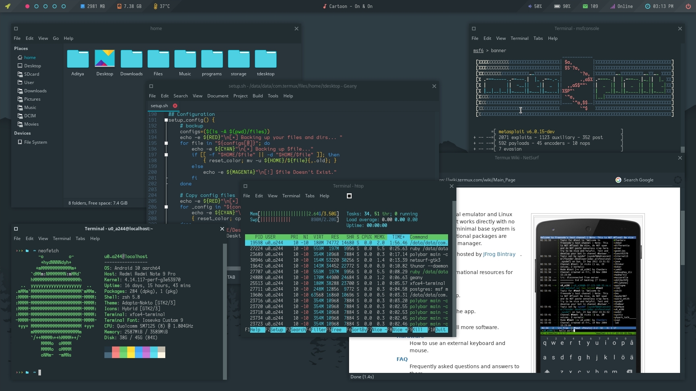|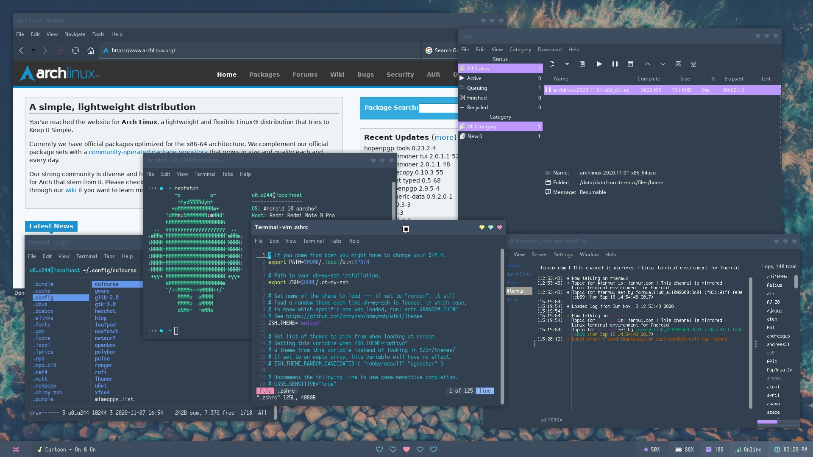|

Lets start from the beginning... <br />

### What is termux?

Termux is an *Android terminal emulator* and **Linux environment** app that works directly with **no rooting** or setup required. A minimal base system is installed automatically - additional packages are available using the *PKG/APT package manager*. More [Here](https://termux.com/)... <br />

Tuxora is built **on top of** Termux: it bundles a complete Termux environment together with the X11 server (`termux-x11`), the Openbox window manager, the Polybar panel, the Rofi launcher and a curated set of desktop apps — all inside a single APK, so it works **offline** out of the box.

### Preparation

Nothing to prepare. You do **not** need to install Termux, Termux:API, a VNC server or a VNC client. Everything the desktop needs is included in the app.

> This build is created and tested on :
>
> Device - **Redmi Note 9 Pro** <br />
> Android - **Android 10 (Q)** <br />
> CPU Type - **aarch64**

### Installation

It is just Termux turned into a desktop — download, open, done. No `pkg`, no `git clone`, no VNC.

- Grab the APK that matches your phone's CPU from the [**Releases**](https://github.com/Frost-bit-star/Tuxora/releases) page:

  | APK | CPU / device |
  |--|--|
  | `..._arm64-v8a.apk` | Almost all modern phones (**aarch64**) — use this one if unsure |
  | `..._armeabi-v7a.apk` | Older 32-bit ARM devices |
  | `..._x86_64.apk` | 64-bit x86 emulators / tablets |
  | `..._x86.apk` | 32-bit x86 emulators |

- Install it. If Android asks, allow **"Install unknown apps"** for your browser/file manager. <br />
- Open **Tuxora**. The pangolin splash plays, then the login appears. Sign in and you land straight on the desktop. <br />

> Each release APK ships its own, pre-installed copy of the whole desktop — so the first launch works without internet and without installing anything inside Termux.

### Uninstallation

Just uninstall the **Tuxora** app like any other Android app. Everything it created lives in its own private app data and is removed with it.

### First Impression

The desktop boots straight into **Openbox + Polybar + Rofi** with the Tuxora theme. Some of the programs you'll find already installed -

|File Manager (Tuxora Files)|Text Editor/IDE (Geany)|
|--|--|
|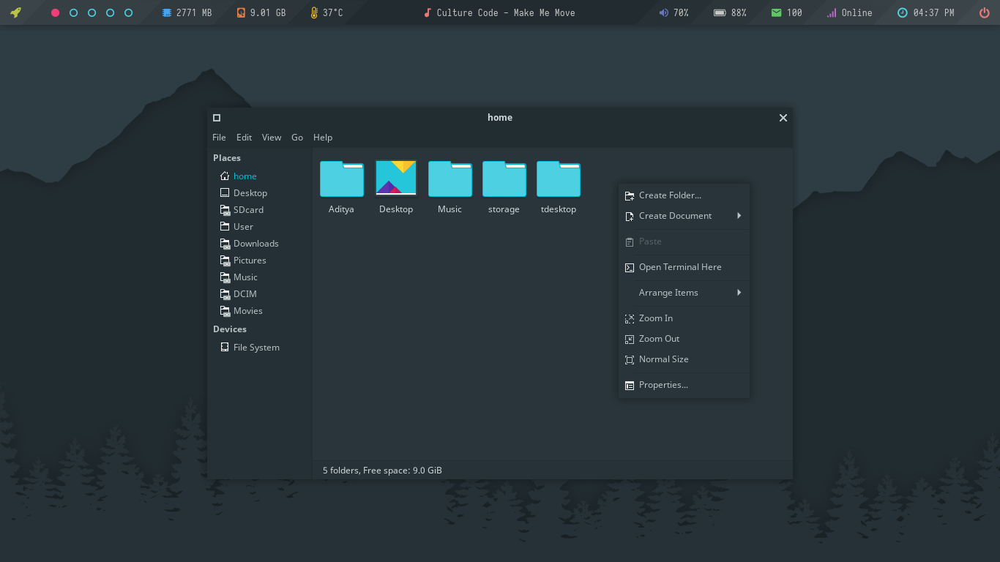|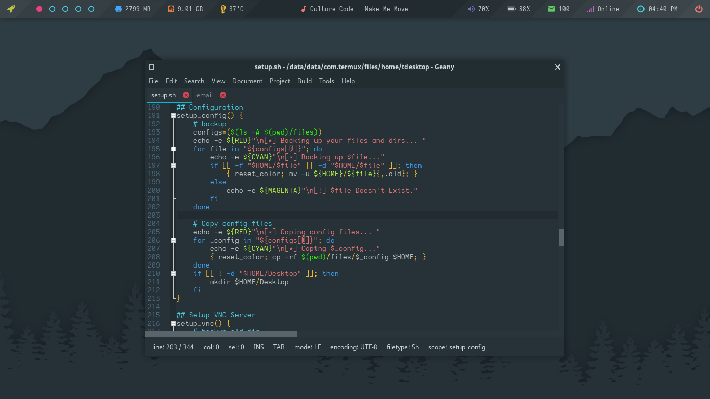|

|Terminal Emulator (Tuxora Terminal)|Web Browser (Netsurf)|
|--|--|
|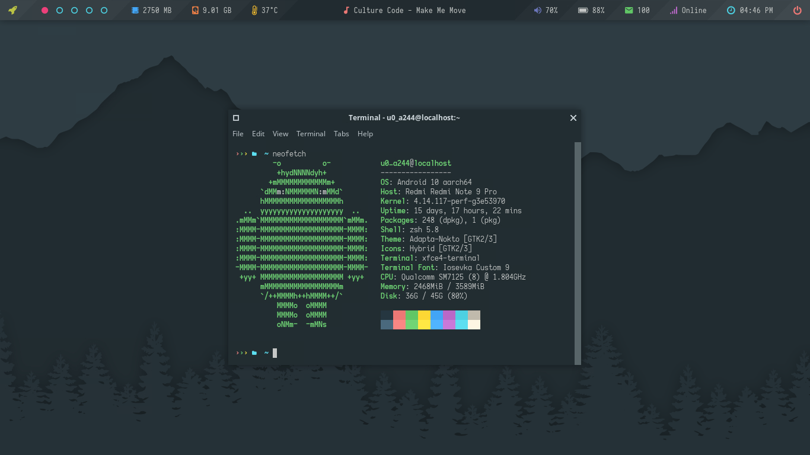|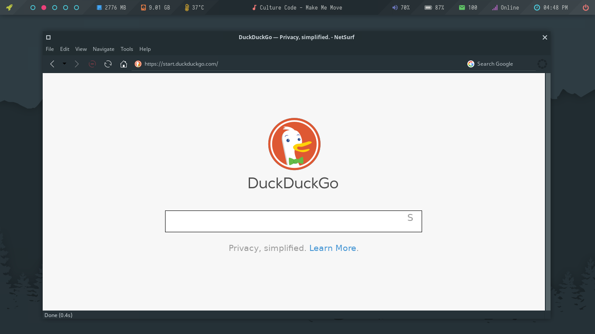|

|Openbox right-click menu|All Applications|
|--|--|
|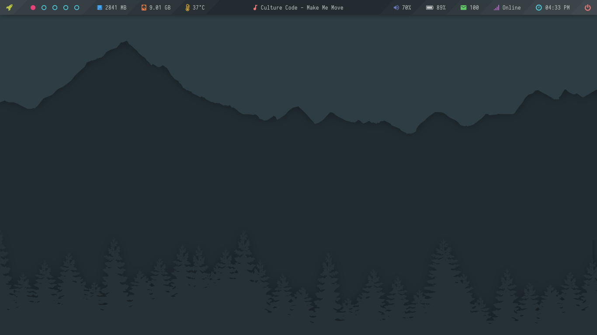|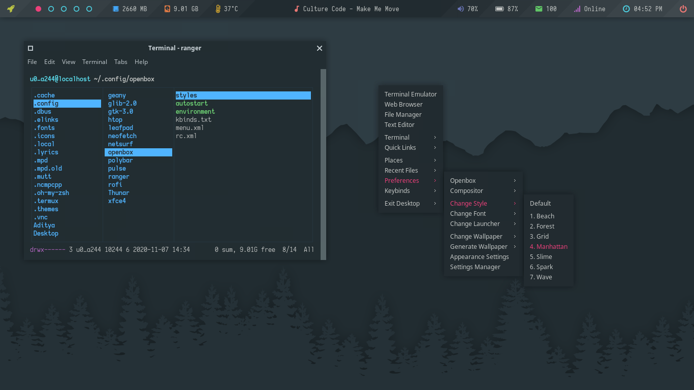|

### The desktop

- **Terminal:** `xfce4-terminal` (also `vim`, `nano`, `htop`, `ranger`, `ncmpcpp`, `mutt`...).
- **Files:** `thunar`.
- **Browser:** `netsurf-gtk3`.
- **Launcher:** click the menu icon on the bar, or press `W-p` / `A-F1` to open **Rofi**.
- **Right-click on the desktop** for the full Openbox menu (Preferences, Keybinds, Places, Recent Files, Exit...).

### Sync your installed apps

Any GUI app you install inside Termux (anything with a `.desktop` entry under `$PREFIX/share/applications`) is automatically surfaced on the desktop. This runs once during setup, and you can rerun it any time:

```bash
tuxora-sync-apps          # refresh the launcher cache and list detected apps
tuxora-sync-apps --list   # just list the parsed applications
```

Installed apps appear in the `rofi` launcher and under `Right click on desktop > All Applications`.

### Applications of `Tuxora Desktop`

Well, these are some ideas or things you can do with a Termux desktop. From learning coding to penetration testing, chatting over IRC to browsing the web and downloading files, playing classic retro games to running Windows from the 90s.

- Learn and practice your coding skills without having a laptop

|Python|Bash|
|--|--|
|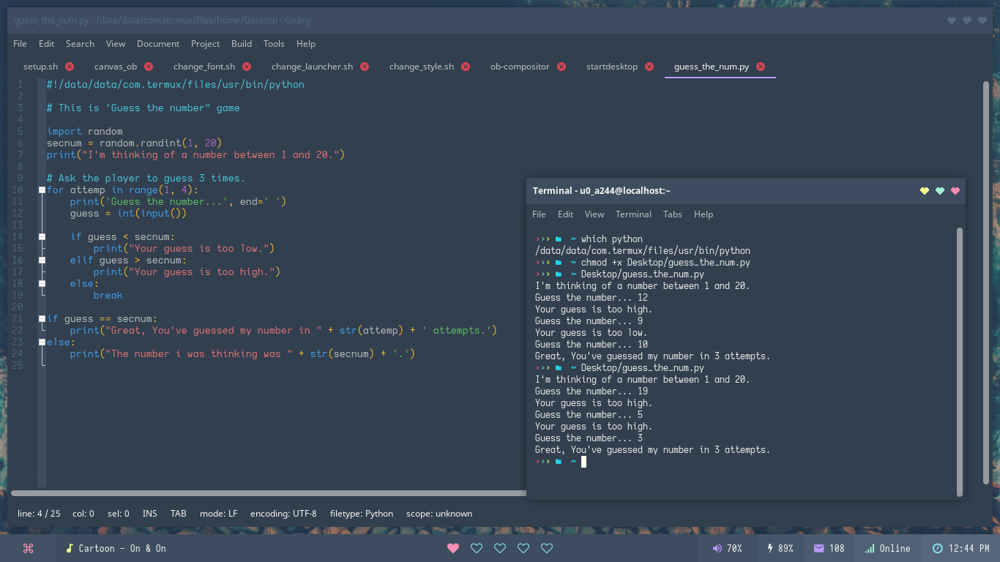|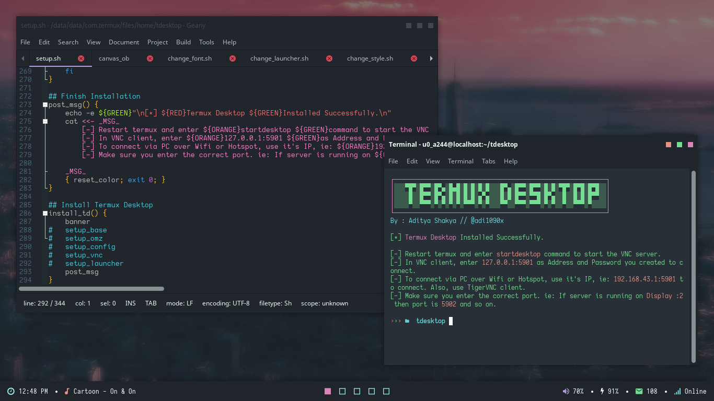|

- Chatting, web browsing and downloading files

|Hexchat & Pidgin|Netsurf & Uget|Browsing Wiki|
|--|--|--|
|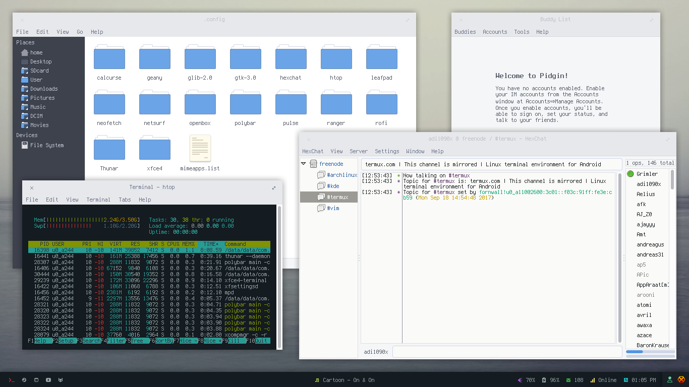|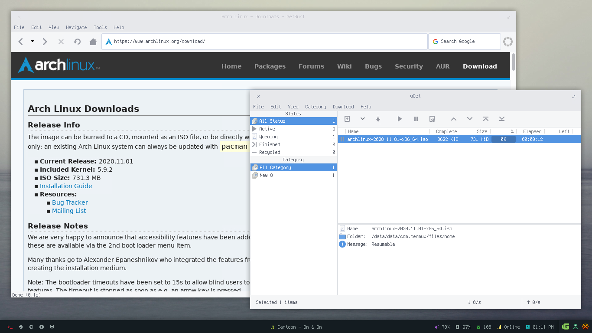|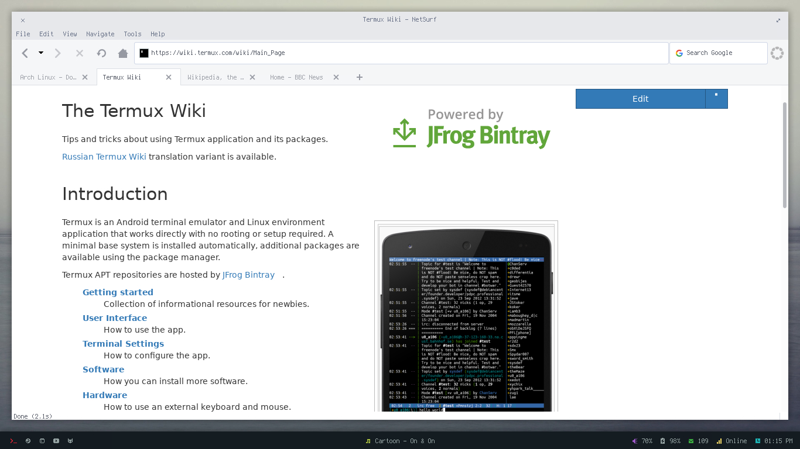|

- Penetration testing and learning cyber security stuff

> I'm not doing anything **illegal** or sponsoring any kind of **Hacking and Cracking**. *Termux is a powerful tool, use it with responsibility.* <br />

|Metasploit - Sherlock - Socialfish - Zphisher - Sqlmap|
|--|
|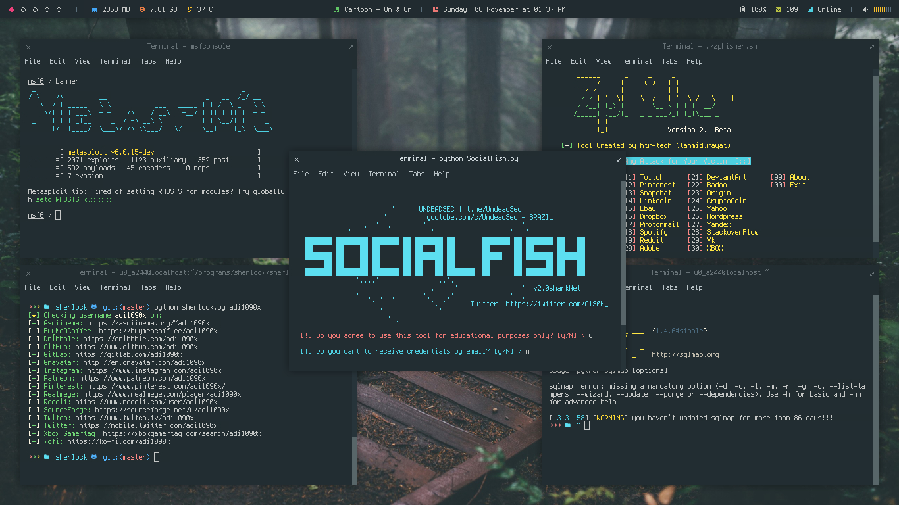|

- Play classic retro games or run Microsoft Windows from the 90s with `Dosbox`

|Turbo C++, Windows 1 and Windows 3|Duke and Blue Brothers|
|--|--|
|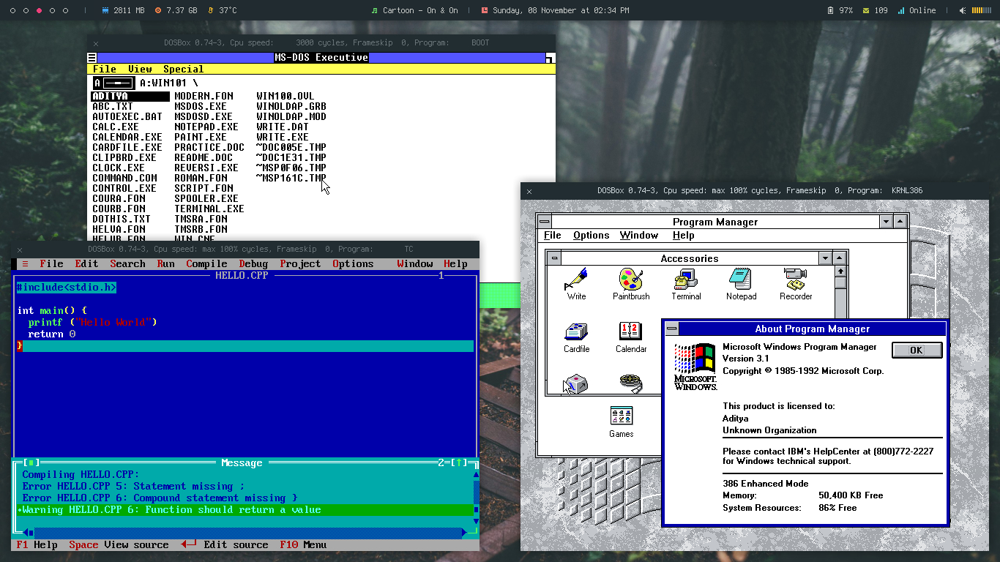|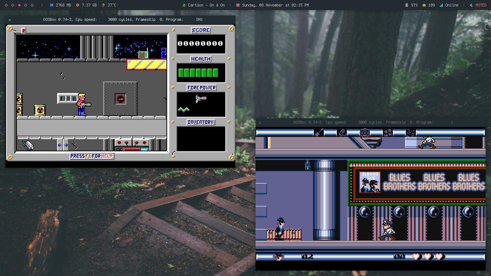|

|Mario and Pacman|Prince of Persia (both)|
|--|--|
|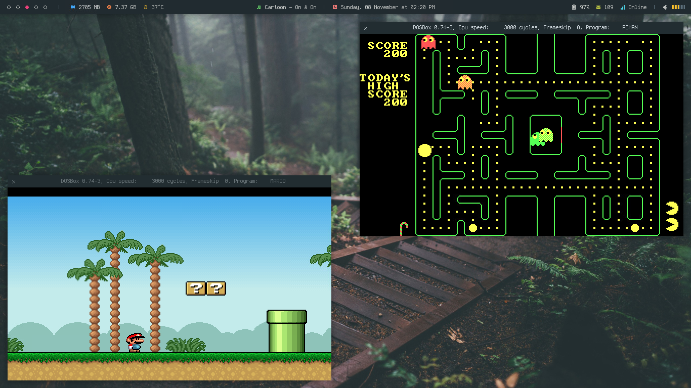|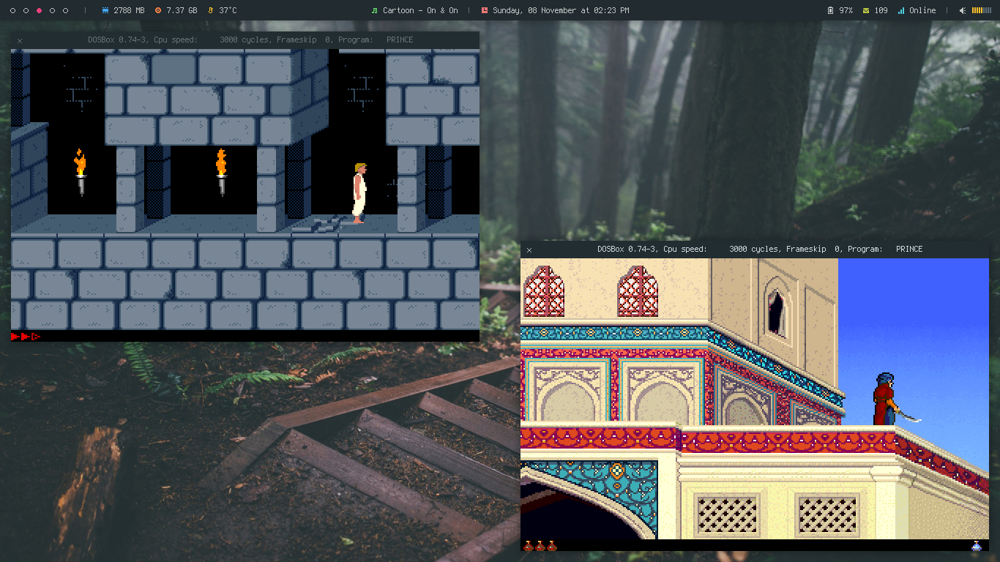|

|Wolfenstein and Turrican2|SuperKarts and Spiderman|
|--|--|
|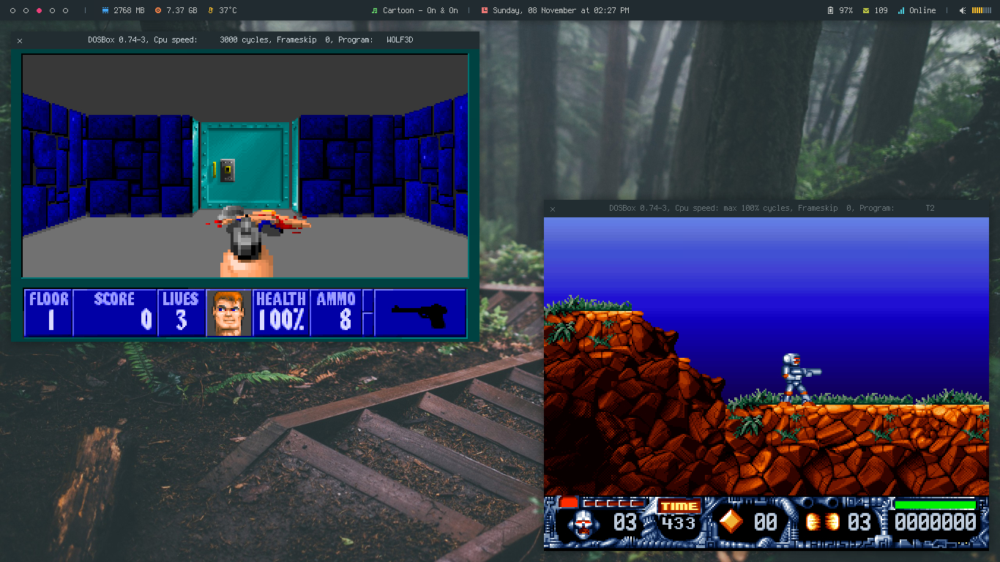|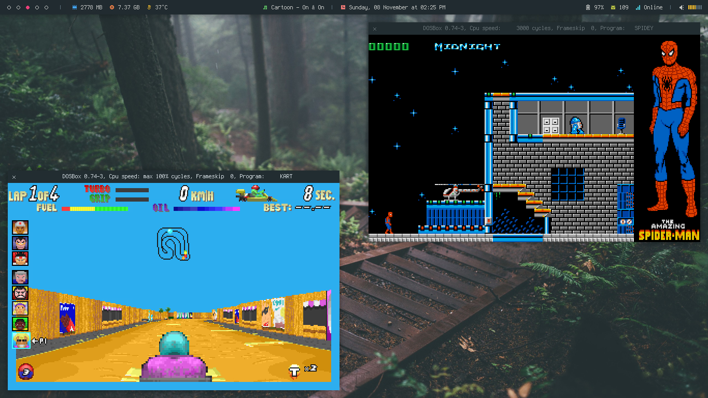|

### Keybindings

Here are some shortcut keys you can use to speed up your work. For more, `Right click on desktop > Keybinds`.

|Keys|Action| ----- |Keys|Action|
|--|--|--|--|--|
| `W-1` | Go To Desktop 1 |  |`S-W-1` | Send To Desktop 1 |
| `W-2` |	Go To Desktop 2 |  |`S-W-2` | Send To Desktop 2 |
| `W-3` |	Go To Desktop 3 |  |`S-W-3` | Send To Desktop 3 |
| `W-4` |	Go To Desktop 4 |  |`S-W-4` | Send To Desktop 4 |
| `W-5` | Go To Desktop 5 |  |`S-W-5` | Send To Desktop 5 |
||||||
| `W-S-Left` | Send To Prev Desktop |  | `W-S-Right` | Send To Next Desktop |
| `A-Tab` | Next Window (Current Workspace) |  |`W-Tab` | Next Window (All Workspaces) |
||||||
| `W-h` | Move to TopLeft |  | `W-j` | Move to BottomLeft |
| `W-k` | Move to TopRight |  | `W-l` | Move to BottomRight |
| `W-Left` | Move To Left Edge |  | `W-Right` | Move To Right Edge |
| `W-Up` | Maximized |  | `W-Down` | Unmaximized |
||||||
| `W-q/c` | Close Windows |  | `A-r/m` | Toggle Resize/Move |
| `W-Space` | Openbox Menu |  | `W-p/A-F1` | App Launcher |
| `W-d` | Toggle Desktop |  | `W-v` | Set Tasks |
||||||
| `W-f` | File Manager |  | `W-e` | Text Editor |
| `W-f`/`W-t` | Terminal |  | `W-b` | Web Browser |
| `W-Space` | Openbox Menu |  | `W-q` | Close Window |

### Troubleshooting

**Desktop never appears / app closes right after tapping Sign in** <br />
The first launch extracts the bundled environment and desktop files, which can take a little while. Wait a few seconds. If it still fails, open the app again; the extraction marker is written once it succeeds.

**No sound / music "plays" but you hear nothing** <br />
Audio is routed through PulseAudio to the Android **AAudio** output. On some devices the
system `default.pa` ships with the Android sink disabled and falls back to a silent dummy
sink (`auto_null`). If you have no sound -
```
# Make sure the real Android sink is the default:
pactl info | grep "Default Sink"      # should say AAudio_sink
pactl load-module module-aaudio-sink  # load it manually if missing
pactl set-default-sink AAudio_sink
```
If that doesn't stick, enable it permanently and restart the daemon -
```
sed -i 's|^load-module module-sles-sink|#load-module module-sles-sink|'  $PREFIX/etc/pulse/default.pa
sed -i 's|^#load-module module-aaudio-sink|load-module module-aaudio-sink|' $PREFIX/etc/pulse/default.pa
pulseaudio -k && pulseaudio --start --exit-idle-time=-1
```

**Blurry / not-sharp desktop** <br />
Match the desktop resolution to your screen. The renderer follows the device display, so
rotating to landscape and back forces a full redraw if the first frame looks soft.

### Building from source

The desktop is baked in **before** the APK is built — the GitHub Actions workflow
(`.github/workflows/build.yml`) does this automatically on every `v*` tag:

1. `scripts/build-tuxora-bootstraps.sh` downloads the Termux base plus the whole desktop
   stack (openbox, termux-x11, polybar, thunar, xfce4, geany, netsurf, ...) from the
   `termux-main` + `termux-x11` repositories and produces one bootstrap per ABI.
2. The original dotfiles are vendored as `app/src/main/assets/tuxora-home.zip`
   (see `scripts/make-tuxora-home.py`) and extracted to `$HOME` on first boot.
3. Gradle builds one release APK per ABI, signed with the bundled debug key.

The resulting APKs are attached to the GitHub Release for the tag.

### FYI

- If you face any problem or get any error, you can create an issue & I'll try to help.
- To show unread mail on polybar, edit `~/.config/tuxora/email.conf` and put your Gmail address + a 16-character **App password** (enable IMAP and 2-Step Verification first). The same file is used by `mutt`, so you only set it once.
- You may need to edit some config files according to your need (`~/.mutt/muttrc`, `~/.gitconfig`).
- Don't email or DM me to ask how to hack, I ain't a hacker.
- Have Fun, and share this repository with your friends.
